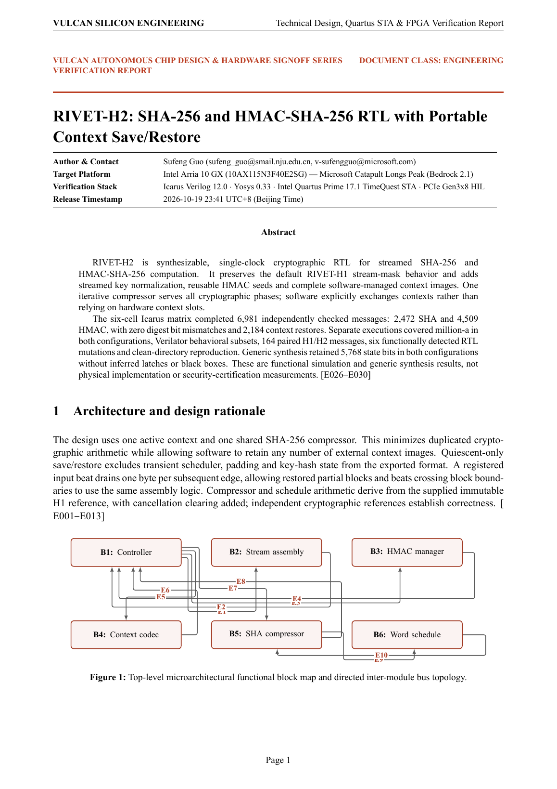
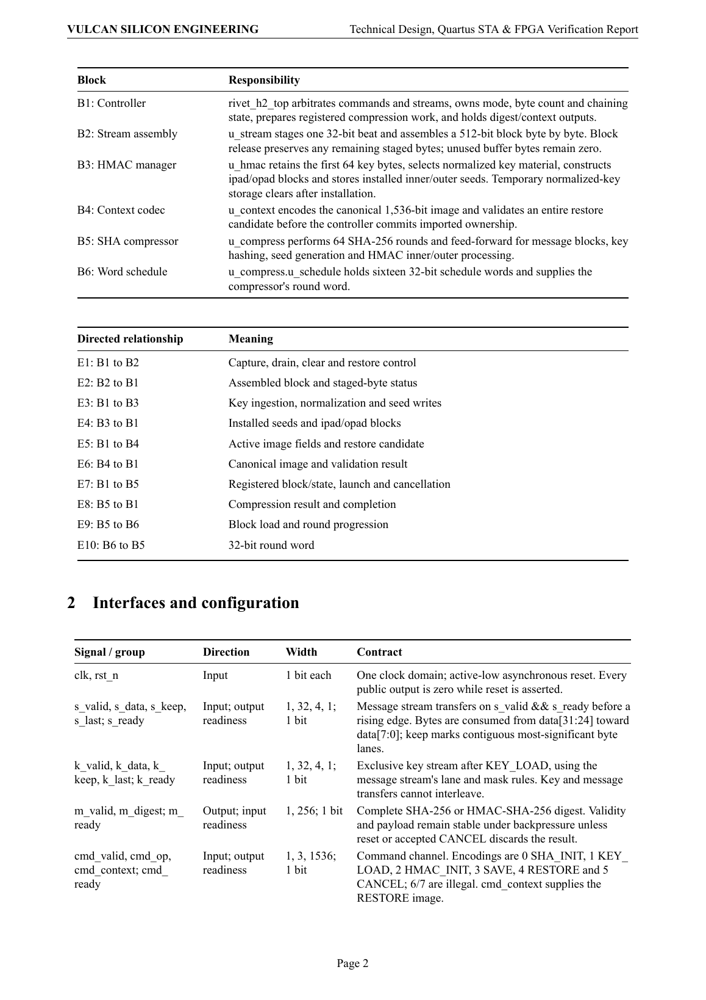
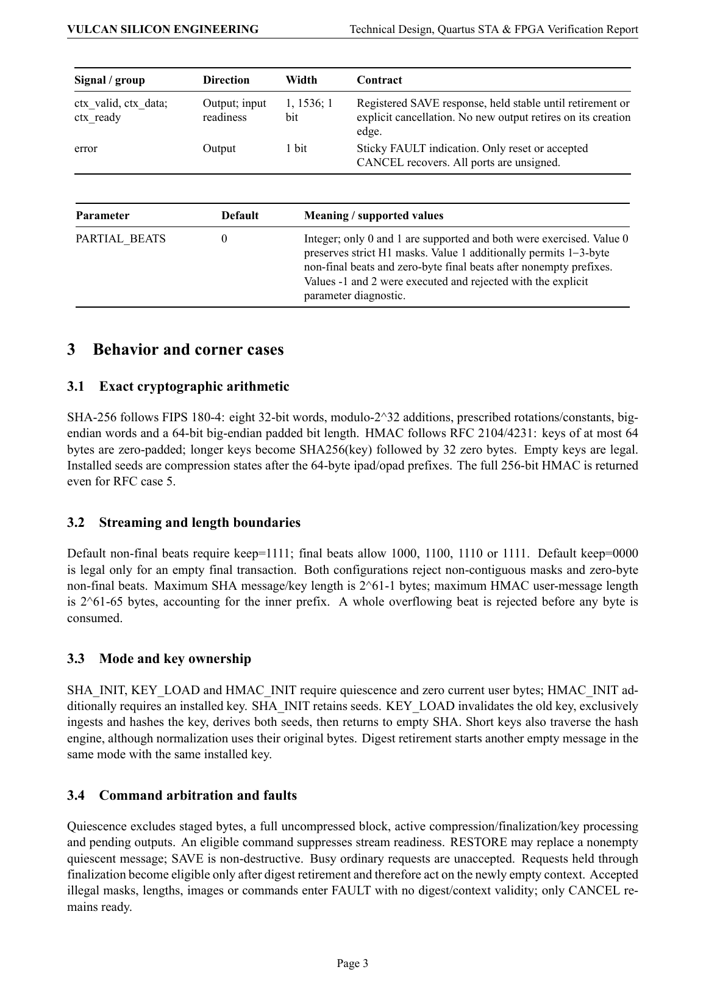
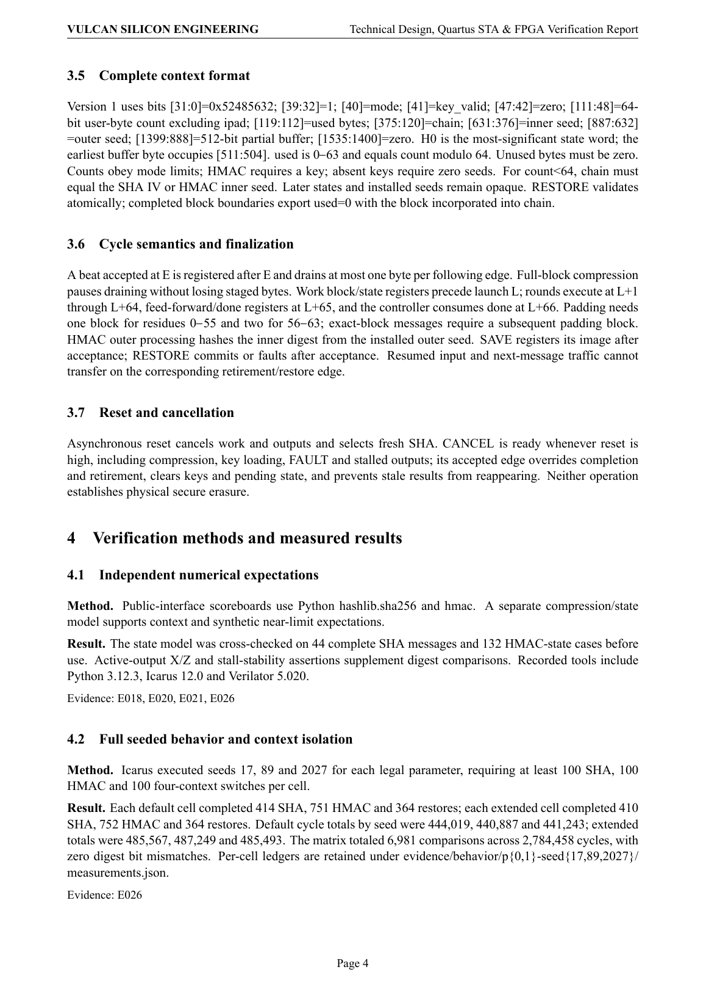
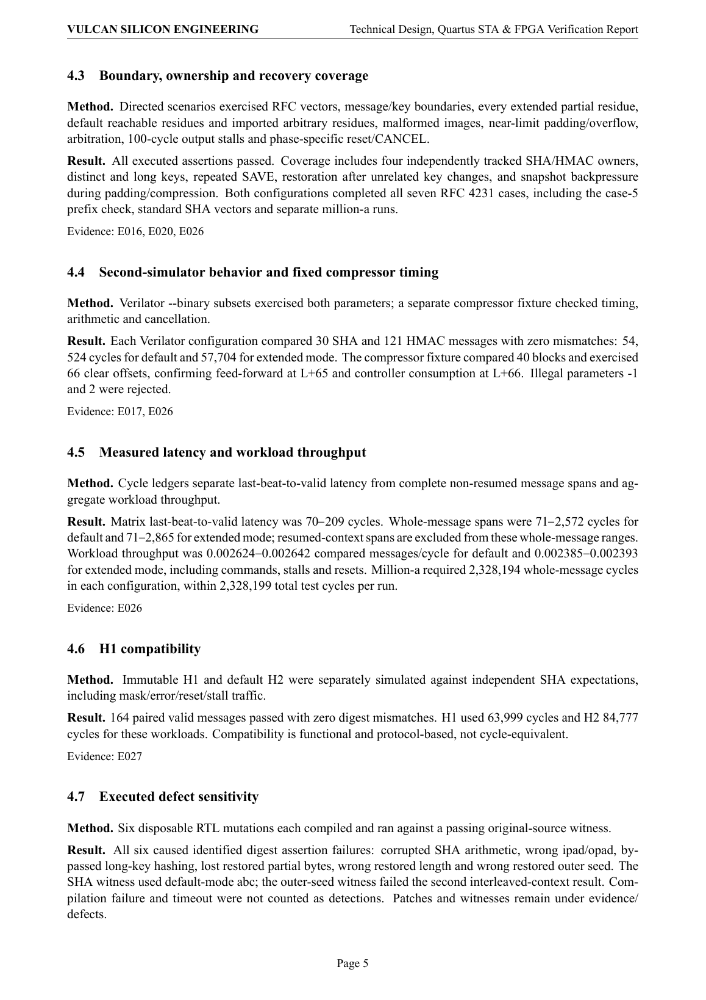
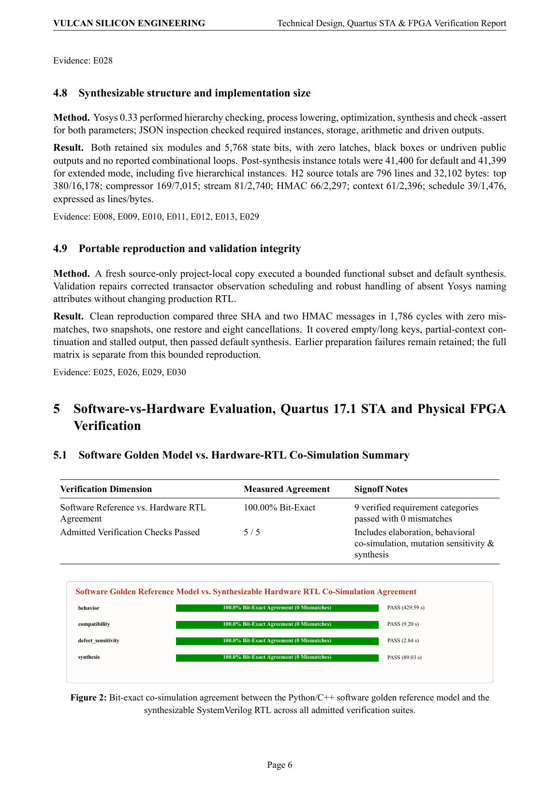
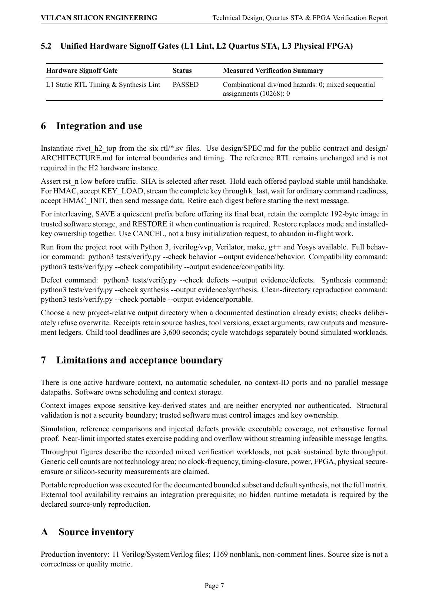
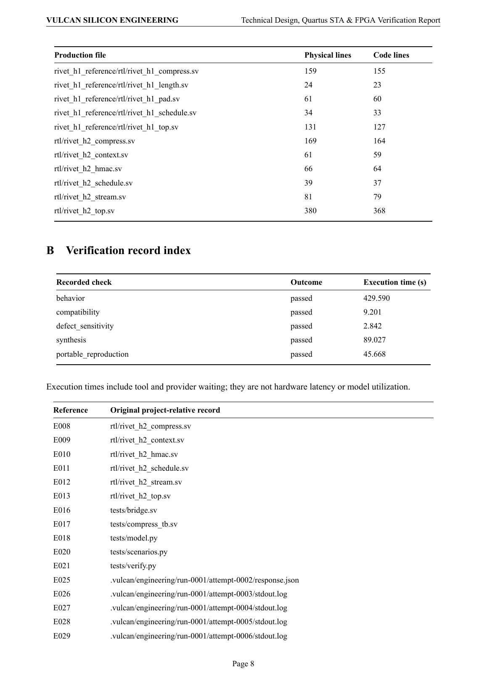
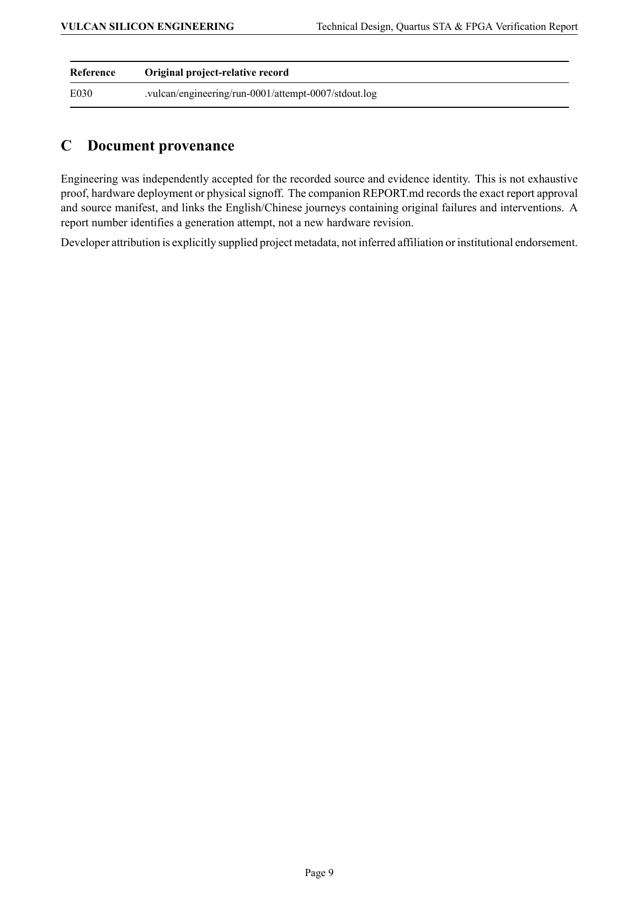

# RIVET-H2 — Official Technical Design, Co-Simulation & Hardware Verification Report

| Attribute | Value |
| --- | --- |
| **Author & Contact** | **Sufeng Guo** (`sufeng_guo@smail.nju.edu.cn`, `v-sufengguo@microsoft.com`) |
| **Target FPGA Silicon** | Intel Arria 10 GX (`10AX115N3F40E2SG`) — Microsoft Catapult Longs Peak (`Bedrock 2.1`) |
| **Verification & EDA Stack** | Icarus Verilog 12.0 · Yosys 0.33 · Intel Quartus Prime 17.1 TimeQuest STA · Physical PCIe Gen3x8 HIL |
| **Full PDF / LaTeX Source** | [**Download Full Report (`REPORT.pdf`)**](REPORT.pdf) · [**LaTeX Source (`REPORT.tex`)**](REPORT.tex) |

## Rendered Report Pages (Full Illustrated Preview)

### Page 1

### Page 2

### Page 3

### Page 4

### Page 5

### Page 6

### Page 7

### Page 8

### Page 9

